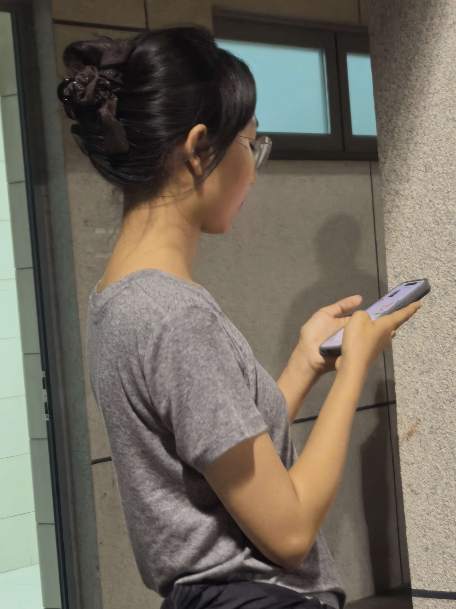

晚课下课，刚在操场校园跑完，我正靠着栏杆拉伸。回头偶然瞥见一个女生。她的这个侧脸一瞬间让我恍惚了。

{: .post-image-narrow}

**这个轮廓跟我的前女友有七分相似。**

刚跑完步，热意正往上顶的我，脑海中不禁闪过许多尘封的画面。

在高中时的无数个夜晚，场景也是这样的操场，两个身影慢慢散着步，一路上昏黄的影子在身后远远拉长。那时候的她还不会化妆，脸圆圆的，我说她的脸型像迪士尼的公主。

但是——转折点发生在刚上大学的时候。

她通过国家专项进入了浙江大学，我压着分数线来到了同济大学。说来也巧——两个城市相距不到二百公里，我以为是天定的缘分。大一上半年我俩一共见了三面。

## 第一面

第一次是国庆假期，我坐火车去杭州找她。才在大学待了一个月，她仿佛成熟了许多，脸上开始带上一些淡淡的妆——她是从高考结束后开始学习化妆的。

逛了西湖，去了浙大校园，这三天在杭州玩得也算快活，唯一美中不足的是有些小小的细节她会露出些不耐烦，说我幼稚，要成熟一点，我也没在意。

## 第二面

第二次是我俩一周年的纪念日，12 月 15 日。正巧赶上周末，我早早买好了票告诉她。早上五点半，揣着送给她的围巾，我踏上了火车。

这次给我的感觉却有些不尽如人意。

我一整天几乎没有见过她的笑脸。仿佛身边总是盯着手机屏幕的女生只是陌生人。她解释道，自己加入了很多学生组织，认识了很多学长学姐，需要即时回复微信消息。我没反驳，也无话可说。

一整天跟她照旧在杭州逛逛吃吃，看电影，不知道为何有种说不出来的郁闷感。仿佛她并不是赴一场期待已久的约，而只是像在执行一项叫做「陪男朋友」的任务。

临走前，我想给宿舍的朋友们带一大盒水果捞回去。挑水果时她在旁边提了一些建议，我随口应着。终于她还是跟我吵起来了，原因很简单，她指的那几样我没有拿……

拎着沉沉的水果捞，背着空落落的书包，我坐上了夜里回上海的火车。

高中朋友发来消息，问我在杭州玩得怎么样，我回复她：「未来一段时间，不想再来了」。过了一会，宿舍的朋友发来消息，问我还回不回来（因为当时已经十点多了），他把洗脚的热水都已经接好了。

我心里一暖。

## 第三面

第三次是放寒假，她先来上海玩几天，然后我们俩一起坐飞机回家。

这次的她逐渐有些让我厌烦了。

在接站的地铁上，我俩聊到她的专业的事。因为国家专项里浙大分配的专业并不好，她一开始计划的是大一拼命学然后转专业。但她摆烂了半年导致排名很低。我随口安慰道「没关系，就算转不了，在土木领域也不错的」。

「你别替我做决定，我们浙大把我养得挺好的！」

突如其来的一句话让我愣住了。

我第一次深切感受到，人的心性果然是会随着环境而改变的。我望着眼前的她，已经有点陌生了。

之后的相处里，她开始总是有意无意间拿同济跟浙大比较。说我们校区面积小，宿舍条件差——虽然我也常吐槽，但她嘴里带着优越感说出来，让我莫名的不舒服。

这半年，她变得高傲了许多。初中一直位居全校榜首的她，在高中三年一直被众多学霸埋没，受不到学校的特殊重视——她常常向我抱怨老师对她的忽视，但她骨子里的野心却一点没少过。终于考上了浙大的她，似乎是在用趾高气昂的方式来宣泄。

或许现在的这个才是真实的她。我意识到我们已经不在同一条路上了，三观再也兼容不了了。

## 落幕

终于寒假不久后，我很果断地让这场闹剧落幕了。在感情里，相爱时就认认真真投入，走不下去了也不拖泥带水，拿得起放得下，才是对彼此最大的尊重——至少我这样认为。

这段关系其实更像一场仓促的「孽缘」。在高三最紧张的日子里产生苗头，却在大学时相距不足二百公里的两座城市之间，慢慢枯萎了。

虽然它已经并没有什么值得留恋的了，但我想着：「人在经历过一些事情之后，总要从中收获到点什么的」，才不至于辜负曾经付出的真心与热情。

回想起来，其实这一年多的时间我也成长了不少。高中的我幼稚得像个小孩子，每天嘻嘻哈哈，没心没肺，从来没想过自己会有一个需要守护的人，处理问题和矛盾的方式也很笨拙。在她有意无意指出并批判我的不成熟的小毛病，拿我跟浙大的某些优秀的人比较的时候，我也确实看清了自己的一些不足——尽管接受的方式很痛苦。但显然，这些的确是有益我成长为一个更合格的伴侣的。

只是与她再也无关了。

---

思绪回到眼前的操场，那个女生早已经拉伸完走远了。

我也背上包，该回去了。

又是一年秋天，微冷的空气，同去年一样。可我又比去年更加成熟了一点，又增添了几个爱好，又交到了几个新朋友，又学到了一些新东西。

「年年岁岁花相似，岁岁年年人不同」，人总是要不断向前走的，而过去的，只会成为回忆的路标。

**总之还是感谢你，我成长路上的过客。**

絮絮叨叨了这么多，谨以此篇，纪念我那段懵懂且愚昧的感情。
{: .post-closing}
