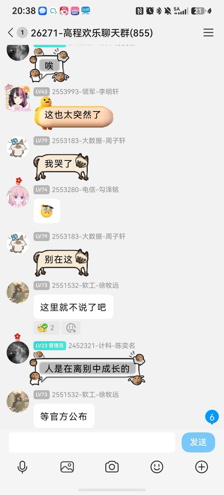
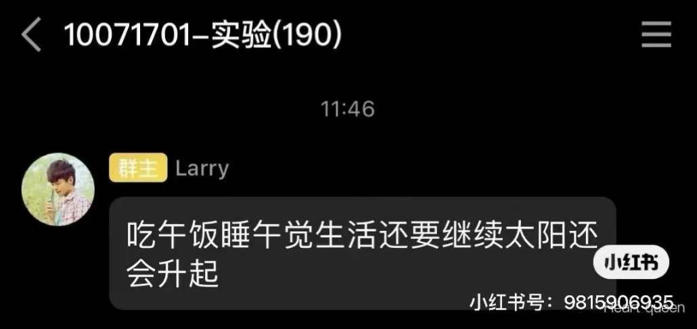

和平常的夜晚一样，图书馆亮着暖烘烘的灯，每个人沉浸在自己的学习中，一切都静悄悄的。

突然朋友发来消息，我伸个懒腰，拿起手机看了一眼。

「沈坚好像出事了。」

我一开始不以为意，但这消息似乎发酵得很快，不一会宿舍群又传来消息:

「沈坚有实锤去世了吗，感觉脑溢血很难治啊。」

我开始意识到不对——这并不是玩笑。打开高程欢乐聊天群，发现里面早已乱作一团。

{: .post-image-phone}

我心脏开始狂跳起来，心里有些不是滋味。

四个月前，我的最后一节高程课上，他还站在讲台上，精神饱满、滔滔不绝地在为我们灌输知识。那时在我眼的里，他就像其他所有老师一样，有自己的工作，有自己的生活，也许还有很多尚未完成的计划。

**可仅仅四个月后，之前还真实站在我面前的活生生的人，却已经即将离开这个世界了吗？**

「生命是多么无常，多么脆弱！原来人是随时可能出意外的。」这是我的第一个冒出的想法。

一个人的生命价值，究竟如何衡量？

我一直以为的人生，都是一条不断向上的曲线：顺利考上好大学，学到东西去求职，获得高收入，再去争取更大的成就……现在的我，就正处在大学阶段，每天为了绩点、专业排名、科研项目这些事物而奔波，为了未来更好的就业而努力——我相信大多数与我相似的 985 大学生，人生轨迹都是这样被规划的。

这些事情当然很重要。

可沈老师的突然离开让我意识到：意外是随时可能来临的。假如一个人经过几十年的奋斗，真的取得了这些成就，却如此突然地离开了人世，他的价值该如何评判？这些成就对他而言又有什么意义呢？

**我开始意识到一个问题：我到底要怎么度过我的一生。**

这个问题我想了很久，目前却写不出一个完美的答案。我打算留时间给自己思考，在大二结束前，我一定要想明白这个问题。

我跟 AI 聊了一会，让它给我一些灵感。它告诉我，人生应该至少有两套评价体系：

**第一套：社会评价体系。**你取得了什么成就，拥有多少财富，获得什么地位，为社会创造了多少价值。

**第二套：生命体验体系。**你有没有真切地感受过快乐？有没有爱过别人？有没有认真地体验过这个世界？有没有和重要的人留下值得回忆的时光？

我认为它说得很对。两套价值体系，一套是对他人而言，一套是对自己而言。而第二套价值体系，正是现在越来越内卷的时代的人们所缺少的。

「我们忙着成功，却常常忘了自己正在生活。」

我甚至有些庆幸，自己是个对生活感触比较多的人，只是有时候不知如何表达。

既然生命有限，那就更应该想一想：**自己现在正在做的这些，究竟能够换来怎样的人生。自己想要的究竟是什么。**

这个问题我可以回答：我想要的，不是豪车豪宅，不是锦衣玉食——我想去看看世界，想去不同的地方，感受不同的文化；想去阅读各种各样的我喜欢的书，给自己时间和空间去让思想飞扬；想去发展自己各种各样的爱好，去接触和学习各种事物。

可是谁都清楚现实世界残酷的运行逻辑——没有一定的财富基础，以上种种只会是空中楼阁。

所以，高考填报志愿时，我跟父母优先考虑的是计算机和电子信息类的专业，原因很现实——进大厂，收入高。

我曾经幻想过自己进互联网大厂工作的生活：每天早上九点去上班，晚上九点下班，周末如果双休的话，比起好好休息和陪伴家人，我或许还要挤出时间去学习新框架与新技术，以适应这个飞速迭代的行业。如果是遇到项目推进的紧要关头，可能又会在公司通宵个几天，双休也可能会变成单休或不休。好处是，这份工作基本能保障衣食无忧，可以过上安稳的生活；坏处也很明显——自由度和生活质量很难保证，高强度的工作对于身体健康的压榨也是恐怖的，35 岁之后学习能力逐渐式微的自己，能否依然保持行业竞争力，也是未知数。

这样的一生，会是我想要的吗？若是如此过完了青春，我会后悔吗？

当然，我现在对于企业职场的了解还不够深入，未来的时代，由于 AI 的迅速迭代，必然还会发生翻天覆地的变化，所以我的人生远没有到一眼望到头的地步。

算了，今晚有点想远了。没有人能准确预测自己的未来，想多了反而让自己焦虑。

---

**「我到底要怎么度过我的一生。」**这或许会成为我一生的课题，值得我在以后的日子里继续花时间，去细嚼慢咽。

晚安，沈坚老师。愿您在那边没有烦恼，一切安好。

您为我上的最后一课，原来不是高程。
{: .post-closing}
